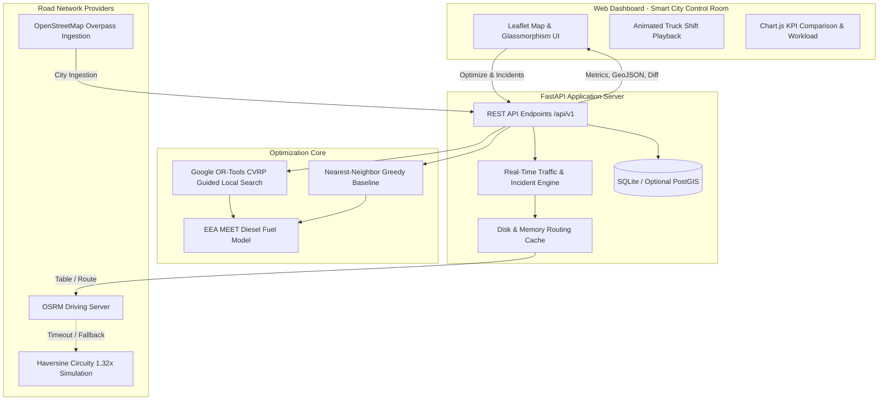

# ♻️ EcoRoute AI — Municipal Waste Collection Route Optimizer

An AI-powered, software-only platform for optimizing municipal solid waste collection routes using mathematical operations research (**Google OR-Tools**), real-world road networks (**OSRM**), and an interactive smart-city operations dashboard (**FastAPI + Leaflet + Chart.js**).

> **Core Architectural Constraint:** **100% Software-Only** — Strictly zero IoT sensors, smart bins, RFID tags, or vehicle GPS hardware required. All operational updates, dynamic events, and re-optimizations are managed through the web interface and REST API.

---

## 🌟 Key Capabilities

1. **Mathematical Optimization Engine (Google OR-Tools)**
   - Formulates the problem as a **Capacitated Vehicle Routing Problem (CVRP)** with shift duration bounds and depot return constraints.
   - Solves using **Guided Local Search (GLS)** metaheuristic with `PATH_CHEAPEST_ARC` initial solution.
   - Dynamic fleet sizing penalizes fixed vehicle startup costs to minimize the dispatched trucks and maximize fleet utilization.
   - Graceful infeasibility handling with detailed diagnostic breakdown (`capacity_exceeded`, `shift_time_exceeded`, `priority_dropped`, `fleet_exhausted`).

2. **Real-World Road Network Integration & Circuity Fallback**
   - Directly queries **OSRM (Open Source Routing Machine)** for `/table` distance/duration matrices and `/route` turn-by-turn road geometries.
   - **Offline High-Precision Fallback:** If OSRM is unreachable, rate-limited, or coordinates exceed batch limits, automatically engages a calibrated Haversine road-network simulation with an urban **circuity factor of 1.32x** and **27 km/h (7.5 m/s)** municipal truck speed.
   - Disk and in-memory caching in `.cache/` guarantees instant offline routing.

3. **Objective Baseline Benchmark (Nearest-Neighbor Heuristic)**
   - Compares Google OR-Tools side-by-side against a greedy **Nearest-Neighbor constructive baseline** using identical stops, vehicle capacities, and constraints.
   - Transparently computes:
     - **Distance Saved (km & %)**
     - **Fuel Saved (L diesel)** via the European Environmental Agency (EEA) MEET refuse truck model
     - **CO₂ Emissions Reduced (kg)** (2.68 kg CO₂/L)
     - **Cost Savings (₹ / INR)** factoring local fuel (₹94.50/L) and crew wages (₹250/hr)
     - **Workload Balance (Standard Deviation in km)**

4. **Real-Time Traffic Congestion & Load-Aware Fuel Model**
   - **Time-of-Day Traffic Flow:** Automatically applies time-of-day speed reduction factors (Morning Peak, Mid-Day Flow, Evening Rush, Night Free-Flow).
   - **Spatial Traffic Bottlenecks:** Calibrated with 8 verified high-density congestion choke-points across Pune (Shivajinagar, Swargate, Laxmi Road, Deccan Gymkhana, Karve Road, Hadapsar, SPPU Circle, Market Yard).
   - **EEA MEET Heavy Vehicle Fuel Model:** Computes empty vs full load compaction consumption (0.36 to 0.54 L/km), idle delay consumption (2.4 L/hr), and hydraulic compactor Power Take-Off (0.035 L per bin lift).

5. **Event-Driven Dynamic Re-Optimization & Undo**
   - All 4 incident types dynamically alter route assignments:
     - 🚧 **Road Closure:** Heavily penalizes intersecting road segments, forcing turn-by-turn geometry to detour around the blockage.
     - 🚗 **Traffic Jam:** Elevates corridor congestion multiplier.
     - 🚨 **Emergency Bin Overflow:** Inserts an urgent Priority 4 collection point into the active schedule.
     - ⚠️ **Missed Collection Stop:** Marks stop for immediate re-visit.
   - **Undo & Reset Actions:** Revert the most recent incident or reset cleanly to the initial baseline with instant route diff reporting.

6. **100% Free Open-Source Ecosystem & Exports**
   - **Dynamic City Ingestion:** Ingest collection points and recycling nodes for any global city on-demand via the free **OpenStreetMap Overpass API**.
   - **GIS Standards Export:** One-click download of **GeoJSON** for QGIS/ArcGIS, **Driver Manifest CSV**, and printable **Driver Shift HTML Reports**.
   - **Zero API Fees:** Zero dependency on proprietary Google Maps or Mapbox APIs.

---

## 🏛 System Architecture



---

## 🚀 Quick Start

### Option A: Local Python Run (Recommended — Zero-Friction)

```bash
# 1. Clone repository
git clone https://github.com/me13krishna/WasteCollectionRoute.git
cd WasteCollectionRoute

# 2. Install dependencies
pip install -r backend/requirements.txt

# 3. Launch application
python main.py
```

Open **[http://127.0.0.1:8000](http://127.0.0.1:8000)** in your browser!

### Option B: Docker Compose

```bash
docker compose up --build
```

The container automatically launches FastAPI, mounts SQLite, and connects to the routing engine with healthchecks enabled.

---

## 🖥 Pune Smart City Demo Walkthrough

When presenting this project to evaluators or mentors, follow this step-by-step sequence:

1. **Inspect Initial State & Landmarks:**
   - Notice the central depot placed at PMC Ghole Road, Shivajinagar (`18.5284, 73.8480`).
   - 80 authentic municipal collection points are preloaded across Pune (Shaniwar Wada, Kasba Peth, Laxmi Road, Fergusson College Road, Deccan Gymkhana, Swargate, Kothrud).
   - Point out the status indicators: **Live OSRM Engine / Fallback Circuity Mode** and **Real-Time Traffic Status**.

2. **Execute Optimization:**
   - Under the **"Optimize"** tab, leave the sliders at 50 stops and 4 vehicles with objective set to **"Fuel & CO₂ Emissions"**.
   - Click **"⚡ Optimize Multi-Vehicle Routes"**.
   - Within 1–3 seconds, Google OR-Tools Guided Local Search produces optimal multi-vehicle routes.
   - The map automatically fits to bounds and draws road-conforming colored polylines with stop-sequence numbering.

3. **Verify Scientific Savings & KPIs:**
   - Review the **Results** tab:
     - Notice the **15% – 25% savings** in distance, diesel, and operational costs over the Nearest-Neighbor baseline.
     - Inspect the **Baseline vs OR-Tools** comparison bar chart and the **Vehicle Workload Balance** chart.
     - Notice how fixed vehicle costs minimize dispatched trucks (keeping idle trucks in reserve).

4. **Run Animated Shift Playback:**
   - In the bottom simulation dock on the map, click **▶️**.
   - Adjust the speed slider (1x, 2x, 5x, 10x) and watch truck markers progress along real road geometry with real-time shift elapsed timers.

5. **Test Dynamic Re-Optimization & Rerouting:**
   - Open the **"Incidents"** tab.
   - Click **"🚧 Place Road Closure (Click Map)"**.
   - Click on any active route segment (e.g., near JM Road or Karve Road).
   - Notice the system immediately logs the incident, adds a spatial detour penalty, re-solves the CVRP, updates turn-by-turn road geometry, and displays a **Before / After Route Diff**.
   - Click **"↩️ Undo Last Incident"** to watch the plan seamlessly restore previous assignments.

6. **Export Manifests & Reports:**
   - Open the **"Export"** tab.
   - Click **"🖨️ Open Printable Driver HTML Shift Report"** to view a paperless dispatch manifest with driver signature lines and stop ETAs.

---

## 📡 REST API Reference

| Method | Endpoint | Description | Status Code |
| :--- | :--- | :--- | :--- |
| `GET` | `/api/v1/config` | Platform configuration, constants, SI units, and pricing factors | `200 OK` |
| `GET` | `/api/v1/routing/status` | Current OSRM routing engine status (Live vs Fallback Mode) | `200 OK` |
| `GET` | `/api/v1/dataset` | Current collection points, depot, fleet, and active incidents | `200 OK` |
| `GET` | `/api/v1/traffic/status` | Real-time traffic congestion factor and Pune bottleneck hotspots | `200 OK` |
| `POST` | `/api/v1/dataset/randomize` | Replaces the collection points with a fresh random layout around the depot (`count`, `radius_km`, optional `seed`) | `200 OK` |
| `POST` | `/api/v1/optimize` | Runs Google OR-Tools CVRP solver with Guided Local Search. `fleet_mode: "exact_fleet"` dispatches exactly `active_vehicles_count` trucks | `200 OK` |
| `POST` | `/api/v1/optimize/fleet-sweep` | Plans the same points for 1…N trucks and returns distance, finish time, fuel, cost and per-truck detail for each, plus the recommended count | `200 OK` |
| `POST` | `/api/v1/incidents` | Reports live incident (closure, jam, overflow) & triggers re-routing | `200 OK` |
| `POST` | `/api/v1/incidents/undo` | Reverts the last incident and restores the prior route plan | `200 OK` |
| `POST` | `/api/v1/incidents/reset` | Resets all incidents and restores initial baseline plan | `200 OK` |
| `POST` | `/api/v1/osm/extract` | Ingests real collection points for any city via Overpass API | `200 OK` |
| `POST` | `/api/v1/upload-csv` | Uploads a custom collection points CSV file | `200 OK` |
| `GET` | `/api/v1/export/template`| Downloads sample CSV template for collection points | `200 OK` |
| `GET` | `/api/v1/export/geojson` | Exports latest routes and collection points as standard GeoJSON | `200 OK` |
| `GET` | `/api/v1/export/manifest`| Exports downloadable Driver Collection Manifest CSV | `200 OK` |
| `GET` | `/api/v1/export/report-html`| Generates printable HTML driver shift dispatch sheets | `200 OK` |

---

## ⚙️ Configuration Parameters

All parameters can be customized via `.env` or system environment variables:

| Variable | Default Value | Description |
| :--- | :--- | :--- |
| `DATABASE_URL` | `sqlite:///./waste_route.db` | Synchronous SQLite or PostgreSQL connection string |
| `OSRM_BASE_URL` | `https://router.project-osrm.org` | Public OSRM routing endpoint or local container |
| `OSRM_TIMEOUT_SEC`| `2.5` | Timeout before falling back to circuity matrix |
| `OSRM_MAX_RETRIES`| `2` | Number of exponential backoff retry attempts |
| `CURRENCY_SYMBOL`| `₹` | Currency symbol displayed across UI and exports |
| `CURRENCY_CODE` | `INR` | ISO 4217 currency code |
| `FUEL_L_PER_KM` | `0.42` | Base diesel consumption rate for municipal refuse truck |
| `CO2_KG_PER_L` | `2.68` | European Environmental Agency standard diesel emission factor |
| `FUEL_COST_PER_L`| `94.50` | Diesel price per liter in Indian Rupees (₹) |
| `DRIVER_HOURLY_RATE`| `250.00` | Driver and crew hourly rate in Indian Rupees (₹) |
| `CIRCUITY_FACTOR`| `1.32` | Calibrated urban road detour multiplier over Haversine |
| `TRUCK_AVG_SPEED_KMH`| `27.0` | Average collection truck speed in municipal streets (7.5 m/s) |
| `DEFAULT_OPT_TIME_LIMIT_SEC`| `15` | Default Google OR-Tools search time limit |

---

## 🧪 Testing

The repository includes a comprehensive `pytest` test suite covering mathematical CVRP solvers, nearest-neighbor baselines, EEA fuel models, real-time traffic penalties, and all REST endpoints.

Run the test suite:

```bash
python -m pytest -v
```

---

## 🔧 Troubleshooting

- **OSRM Server Timeouts or Rate Limiting:**
  - *Symptom:* Badge shows `Fallback Circuity Mode`.
  - *Fix:* The platform automatically handles this! It activates the built-in 1.32x urban circuity engine without crashing or disrupting service. For full local independence, follow [docs/OSRM_SETUP.md](docs/OSRM_SETUP.md) to run an offline OSRM container.
- **Port 8000 Already in Use:**
  - *Fix:* Run `uvicorn backend.main:app --port 8080 --reload`.
- **Database Locks on Windows:**
  - *Fix:* Default database uses SQLite with `check_same_thread=False` and synchronous sessions, eliminating thread pool deadlocks across Python 3.11 – 3.14.

---

## 🏷️ GitHub Repository Metadata

- **Suggested Description:**
  > AI-powered, software-only municipal waste collection route optimization dashboard for Pune Smart City using Google OR-Tools CVRP, OSRM road networks, real-time traffic, and Leaflet.
- **Suggested Topics:**
  `cvrp`, `vehicle-routing-problem`, `google-or-tools`, `smart-city`, `fastapi`, `osrm`, `leaflet`, `waste-management`, `pune`, `green-logistics`, `route-optimization`, `gis`
