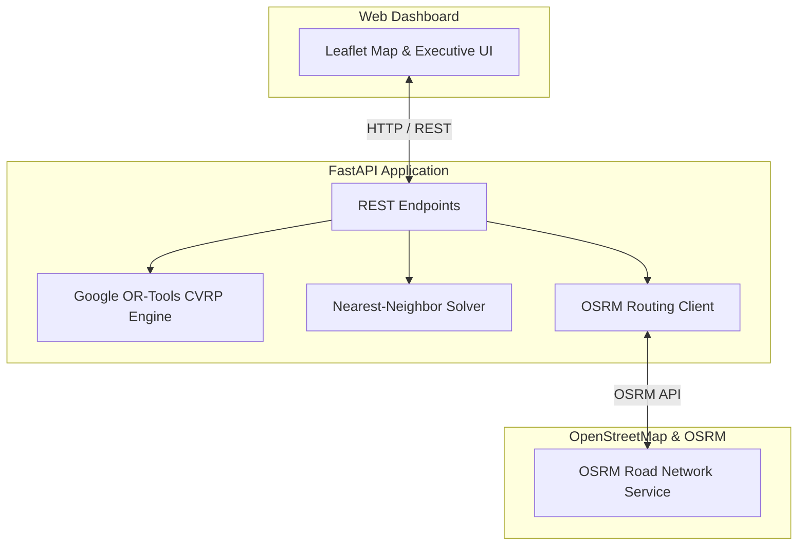

# ♻ EcoRoute AI — Municipal Waste Collection Route Optimizer

An AI-powered, software-only platform for optimizing municipal solid waste collection routes using mathematical operations research (**Google OR-Tools**), real-world road networks (**OSRM**), and modern web GIS (**Leaflet + FastAPI**).

> **Strict Architectural Constraint:** 100% Software-Only — No IoT sensors, smart bins, RFID tags, or vehicle-mounted GPS hardware required. All dynamic updates and reoptimizations are event-driven through the software interface.

---

## 🌟 Key Features

1. **Mathematical Optimization Engine**
   - Implements the **Capacitated Vehicle Routing Problem (CVRP)** with Google OR-Tools.
   - Metaheuristic: **Guided Local Search** with `PATH_CHEAPEST_ARC` initial solution strategy.
   - Respects vehicle payload capacities, maximum shift durations, and return-to-depot constraints.

2. **Real-World Road Network Integration**
   - Directly interfaces with **OSRM (Open Source Routing Machine)** for `/table` distance/duration matrices and `/route` turn-by-turn road geometries.
   - Eliminates Euclidean straight-line assumptions; routes strictly adhere to one-way streets, intersections, and road curvature.

3. **Objective Baseline Benchmark**
   - Compares the OR-Tools optimized solution side-by-side against a standard **Nearest-Neighbor Constructive Heuristic (Greedy)** using identical stops and vehicle capacities.
   - Directly reports transparent metrics:
     - **Distance Saved (km & %)**
     - **Fuel Saved (Liters diesel)** based on published municipal truck factors (~0.45 L/km)
     - **Emissions Reduced (kg CO₂)** (~2.68 kg CO₂/L diesel)
     - **Operational Cost Savings ($)**
     - **Workload Balance (Standard Deviation)**

4. **Software-Driven Dynamic Re-Optimization**
   - Dynamically re-solves routes when real-world operational events occur:
     - 🚧 **Road Closure / Incident:** Automatically routes vehicles around blocked streets.
     - 🚨 **Emergency Overflow Pickup:** Dynamically inserts urgent collection stops into active shifts.
     - ⚠️ **Missed Collection Point:** Reallocates skipped stops to the next available vehicle.

---

## 🚀 Quick Start (Running the Demo)

### 1. Prerequisites
- Python 3.11+
- Web browser (Chrome, Edge, Firefox)

### 2. Install Dependencies
```bash
pip install -r backend/requirements.txt
```

### 3. Start the Platform
```bash
python main.py
```
Or with Uvicorn:
```bash
uvicorn backend.main:app --reload --port 8000
```

### 4. Open in Browser
Open **[http://127.0.0.1:8000](http://127.0.0.1:8000)** to view the live executive dashboard!

---

## 🖥 Mentor Demonstration Walkthrough

When presenting to your mentor or evaluators, follow this 4-step sequence:

1. **Initial State (Map & Collection Points)**
   - Point out the central depot (🏭) and the 80 realistic municipal collection points color-coded by priority (Normal = Blue, High = Amber, Urgent = Red).
   - Explain the software-only premise: no expensive IoT hardware required.

2. **Run Optimization**
   - Click **"Optimize Routes"**.
   - Show how the Google OR-Tools Guided Local Search algorithm generates multi-vehicle routes within seconds.
   - Show how each garbage truck is assigned a dedicated color-coded route following the actual street network.

3. **Verify Scientific Impact (Comparison Card)**
   - Review the **Baseline vs OR-Tools** comparison card.
   - Highlight the **~18% - 25% reduction** in total travel distance, diesel consumption, and carbon footprint.

4. **Demonstrate Dynamic Re-Optimization**
   - Switch to the **"Live Incidents"** tab.
   - Click **"Report Road Closure (Indiranagar 100ft)"** or **"Add Emergency High-Priority Pickup"**.
   - Show that the system immediately recalculates the routes without requiring live GPS hardware.

---

## 🏛 System Architecture



---

## 📁 Repository Structure

```
├── main.py                     # Root execution script (python main.py)
├── Complete_Master_Prompt_...  # Specifications prompt docx
├── Municipal_Waste_Route_...   # Technical master blueprint docx
├── backend/
│   ├── main.py                 # FastAPI application & REST endpoints
│   ├── config.py               # Environmental parameters & constants
│   ├── database.py             # Database session configuration
│   ├── data/
│   │   └── sample_dataset.csv  # 80 realistic district collection points
│   ├── models/
│   │   ├── db_models.py        # SQLAlchemy schema definitions
│   │   └── schemas.py          # Pydantic request/response schemas
│   ├── services/
│   │   ├── vrp_solver.py       # Google OR-Tools CVRP solver
│   │   ├── baseline_solver.py  # Nearest-Neighbor benchmark solver
│   │   ├── routing_matrix.py   # OSRM distance matrix & road geometry
│   │   └── reoptimizer.py      # Dynamic incident re-routing engine
│   └── static/
│       └── index.html          # Executive single-page dashboard UI
└── README.md                   # Project documentation & presentation guide
```

---

## 📜 Academic Attribution & License
- Optimization Engine: **Google OR-Tools** (Apache 2.0)
- Road Network: **OpenStreetMap contributors** (ODbL)
- Routing Engine: **OSRM** (BSD-2-Clause)
- License: MIT
